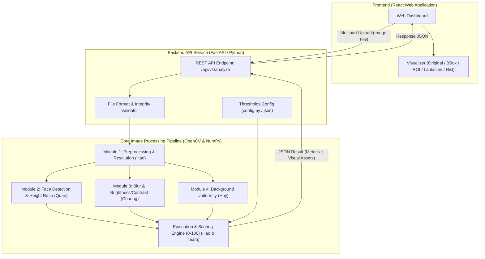

# TÀI LIỆU KIẾN TRÚC HỆ THỐNG VÀ KẾ HOẠCH DỰ ÁN
## ĐỒ ÁN MÔN HỌC: XỬ LÝ ẢNH (DIGITAL IMAGE PROCESSING)
### CHUYÊN ĐỀ: TRÍCH XUẤT ĐẶC TRƯNG TOÀN CỤC (GLOBAL FEATURES)
### ĐỀ TÀI: HỆ THỐNG ĐÁNH GIÁ CHẤT LƯỢNG QUANG HỌC VÀ PHÂN LOẠI ẢNH THẺ TỰ ĐỘNG (PHOTOCHECK)

---

## 1. ĐỊNH HƯỚNG BÁM SÁT MÔN HỌC & CHỐT HẠ ĐẶC TRƯNG LÕI

### 1.1. Lựa chọn nhóm đặc trưng duy nhất: ĐẶC TRƯNG TOÀN CỤC (GLOBAL FEATURES)
* **Quyết định học thuật:** Thực hiện đúng chỉ đạo của Giảng viên hướng dẫn (*"chỉ chọn 1 đặc trưng dựa trên tính chất đề tài rồi phát triển sâu"*), nhóm chốt hạ chọn duy nhất: **ĐẶC TRƯNG TOÀN CỤC (GLOBAL FEATURES - Chương 6 Giáo trình DIP)**.
* **Tính chất đề tài:** Kiểm định chất lượng quang học và điều kiện chiếu sáng (Photometric & Optical Image Quality Assessment - IQA):
  * Nhận diện ảnh thiếu sáng (Underexposure), cháy sáng (Overexposure), ảnh ngược sáng, bạc màu, độ tương phản yếu.
  * Phân tích phân bố phổ màu sắc toàn ảnh (Color Distribution) và cân bằng trắng.
* **Bản chất toán học của Đặc trưng Toàn cục được nhóm triển khai sâu:**
  1. **Bộ 4 mô-men thống kê mức xám (Statistical Moments):**
     * Mô-men bậc 1: Cường độ sáng trung bình (**Mean** $\mu$).
     * Mô-men bậc 2: Phương sai / Độ lệch chuẩn (**Variance / Std Dev** $\sigma$) đo độ tương phản.
     * Mô-men bậc 3: Độ lệch phân bố (**Skewness** $S$) đo độ dồn về tối hay dồn về sáng.
     * Mô-men bậc 4: Độ nhọn phân bố (**Kurtosis** $K$) đo độ tập trung của phổ sáng.
  2. **Biểu đồ Histogram đa kênh & Chuẩn hóa L1 (Grayscale & HSV):**
     * Gom 256 mức sáng thành 16 / 32 bins, chuẩn hóa $\sum p_i = 1.0$ thành vector xác suất.
     * Trích xuất phân bố màu trên không gian HSV (Hue - Saturation - Value) bắt lỗi bạc màu da hoặc ám màu phông nền.
  3. **Độ đo khoảng cách so sánh Vector đặc trưng giữa 2 ảnh:**
     * So sánh ảnh người dùng với ảnh thẻ tham chiếu chuẩn (**Ideal Reference ID Photo**) qua độ đo **Bhattacharyya Distance** $d_B$, **Chi-Square** $\chi^2$, và **Histogram Intersection**.
  4. **Thuật toán tự động hiệu chỉnh (Histogram Equalization & CLAHE):**
     * Khi ảnh bị tối hoặc tương phản kém, áp dụng thuật toán cân bằng lược đồ xám toàn cục để tự động nâng cao chất lượng ảnh.

### 1.2. Vai trò của Giao diện Web (Web Demo Interactive Lab)
* **Web Demo là bắt buộc:** Giao diện Web (React + FastAPI) đóng vai trò là **Phòng Thí Nghiệm Trực Quan Hóa Đặc Trưng Toàn Cục**:
  * Người dùng kéo thả ảnh thẻ $\rightarrow$ Web bóc tách và vẽ trực tiếp biểu đồ ngọn núi Histogram 16 bins.
  * Hiển thị bảng 4 mô-men thống kê ($\mu, \sigma, S, K$) và chỉ số khoảng cách Bhattacharyya $d_B$.
  * Cung cấp nút gạt trực tiếp: **"Tự động cân bằng sáng bằng Histogram Equalization (CLAHE)"** để người dùng và Hội đồng thấy rõ hiệu quả thuật toán xử lý ảnh trước/sau (Before / After).
* **Các module phụ trợ (Kích thước 3:4, Khung mặt Haar, Viền Laplacian):** Được xếp vào nhóm *"Tiền xử lý sơ bộ & Hỗ trợ bố cục (Preprocessing & Layout Aids)"*, giữ nguyên trên Web để demo hoàn chỉnh nhưng khẳng định trước Hội đồng: **Trọng tâm nghiên cứu học thuật của đồ án là Đặc trưng Toàn cục**.

---

## 2. NGUYÊN TẮC VÀNG KHI TRIỂN KHAI VÀ BẢO VỆ ĐỒ ÁN 

> **1. Trả lời thuyết phục câu hỏi của Thầy: "Tại sao đề tài thuộc Đặc trưng Toàn cục?"**  
> *"Thưa thầy, bài toán kiểm định ảnh thẻ chuẩn ICAO/ISO có tiêu chí cốt lõi nhất là điều kiện chiếu sáng và tương phản quang học. Đặc trưng toàn cục quan sát ma trận toàn ảnh, lượng hóa toàn bộ ánh sáng thành vector phân bố xác suất mà không phụ thuộc vào vị trí tọa độ điểm ảnh. Nhóm đã xây dựng bộ vector 18 chiều gồm 4 mô-men thống kê và 16 bins Histogram, đo khoảng cách Bhattacharyya với ảnh chuẩn để đưa ra kết luận phân loại đạt độ chính xác cao."*

> **2. Thực nghiệm khoa học trên 350 ảnh Ground Truth:**  
> Đánh giá hiệu năng phân loại của Đặc trưng Toàn cục trên 350 ảnh (50 ảnh chuẩn, 100 ảnh tối, 100 ảnh cháy sáng, 100 ảnh bạc màu), xuất ma trận nhầm lẫn (Confusion Matrix) và F1-score tối ưu.

---

## 3. PHÂN TẦNG TÍNH NĂNG (FEATURE MATRIX)

```
+------------------------------------------------------------------------+
| [MUST HAVE] Core DIP: Đặc Trưng Toàn Cục & Demo Web                    |
|  - Trích xuất 4 mô-men toàn cục: Mean, Std Dev, Skewness, Kurtosis     |
|  - Trích xuất Grayscale Histogram (16 bins) chuẩn hóa L1               |
|  - So sánh khoảng cách Bhattacharyya với Profile ảnh chuẩn tham chiếu  |
|  - Phân loại chất lượng sáng: ĐẠT / THIẾU SÁNG / CHÁY SÁNG / BẠC MÀU   |
|  - Web UI: Kéo thả ảnh, vẽ biểu đồ Histogram & thẻ kết luận PASS/FAIL  |
+------------------------------------------------------------------------+
| [SHOULD HAVE] Thuật toán nâng cao & Trực quan hóa tương tác            |
|  - Nút bấm tự động cân bằng sáng (Histogram Equalization / CLAHE)      |
|  - Hiển thị ảnh Trước/Sau (Before vs After Equalization) trên Web      |
|  - Báo cáo Benchmark 350 ảnh Ground Truth (Accuracy, F1, Confusion)    |
|  - Giữ lại các bộ lọc hỗ trợ: Bounding Box mặt (Haar), Sharpness (Lap) |
+------------------------------------------------------------------------+
| [NICE TO HAVE] Giai doan 3 - Chi lam neu con du thoi gian              |
|  - Tuy chon Preset chi tiet (Anh 3x4 vs 4x6)                           |
|  - Chup anh truc tiep tu Webcam                                        |
|  - Xuat bao cao ket qua PDF                                            |
+------------------------------------------------------------------------+
```

---

## 4. THIẾT KẾ GIAO DIỆN CHUYÊN NGHIỆP (ENTERPRISE UI SPECIFICATION)

### 4.1. Phong cách & Bảng màu
* **Phong cách:** Minimalist Enterprise SaaS (tương tự giao diện Vercel, Linear, Stripe).
* **Màu sắc chủ đạo:**
  * Background: Slate Dark / Off-white sạch sẽ (`#0f172a` hoặc `#f8fafc`).
  * Primary Accent: Deep Blue / Indigo (`#2563eb` / `#4f46e5`).
  * Status PASS: Emerald Green (`#10b981`).
  * Status FAIL: Crimson Red (`#ef4444`).
  * Status WARNING: Amber (`#f59e0b`).

### 4.2. Bố cục màn hình ứng dụng (2 Cột trực quan)
1. **Header Bar:**
   * Logo & Tên hệ thống: **PhotoCheck - ID Photo Quality Checker**.
   * Badge tiêu chuẩn: `Preset: STANDARD_ID_PHOTO (3:4, Min 600x800)`.
2. **Cột trái (Visual Canvas - 55%):**
   * Vùng Drag & Drop upload ảnh thẻ.
   * **Interactive View Selector (Các tab trực quan hóa từng bước xử lý):**
     * `[Ảnh gốc]` | `[Phát hiện mặt & Tỷ lệ]` | `[Vùng 4 góc nền ROI]` | `[Bản đồ viền Laplacian]` | `[Biểu đồ Histogram]`.
     * Cho phép bật/tắt lớp phủ Bounding Box khuôn mặt và các vùng ROI 4 góc nền.
3. **Cột phải (Diagnostics & Evaluation Panel - 45%):**
   * **Thẻ Kết luận (Verdict Banner):** Phân cấp 3 mức: **ĐẠT CHUẨN (PASS)** (50 - 100 điểm), **TẠM ĐẠT CHUẨN (WARNING)** (35 - 49 điểm), **KHÔNG ĐẠT CHUẨN (FAIL)** (< 35 điểm) kèm **Quality Score (0 - 100)**.
   * **Danh sách điểm tốt (Good Points / Strengths):** Nêu bật các tiêu chí đạt chuẩn và ưu điểm xuất sắc của bức ảnh.
   * **Danh sách lý do vi phạm (Failure Reasons / Areas to Improve):** Nêu rõ nguyên nhân chưa đạt để người dùng dễ khắc phục.
   * **Bảng kiểm định chi tiết các tiêu chí (Criteria Breakdown):**
     1. Kích thước ảnh: Chiều rộng x Chiều cao & Tỉ lệ khung hình (Min `600 x 800 px`, `3:4`).
     2. Số lượng khuôn mặt: Số mặt phát hiện (Yêu cầu duy nhất = 1).
     3. Tỷ lệ chiều cao khuôn mặt: `H_face / H_img` (So sánh với dải ngưỡng thực nghiệm).
     4. Độ sáng & Độ tương phản: Giá trị cường độ trung bình (Mean Intensity) & Std Dev.
     5. Độ rõ nét: Chỉ số phương sai Laplacian `Var(Laplacian)`.
     6. Độ đồng nhất nền: Độ lệch chuẩn màu vùng biên/4 góc `Std Dev (bg)`.

---

## 5. KIẾN TRÚC HỆ THỐNG & LUỒNG DỮ LIỆU ĐỘC LẬP

### 5.1. Sơ đồ kiến trúc tổng thể



### 5.2. Chuẩn giao tiếp độc lập giữa các Module Xử lý ảnh (Interface Contract)

Mỗi thành viên phát triển module độc lập, nhận vào `image: np.ndarray (BGR)` và trả về `dict` kết quả thống kê:

1. **Quân (`face_analyzer.py`):**
   ```python
   def analyze_face(image: np.ndarray) -> dict:
       # Tra ve dict: face_count, bounding_boxes, face_height_ratio, is_centered
       pass
   ```
2. **Chương (`quality_analyzer.py`):**
   ```python
   def analyze_quality(image: np.ndarray) -> dict:
       # Tra ve dict: brightness_mean, contrast_std, laplacian_var, histogram
       pass
   ```
3. **Huy (`background_analyzer.py`):**
   ```python
   def analyze_background(image: np.ndarray, face_boxes: list) -> dict:
       # Tra ve dict: bg_std_dev, corners_std, is_uniform
       pass
   ```
4. **Hảo (`preprocessor.py` & `evaluator.py`):**
   * Tiền xử lý ảnh gốc:
   ```python
   def preprocess_image(file_bytes: bytes) -> tuple[np.ndarray, dict]:
       # Tra ve: (image_cv2, {"width": int, "height": int, "aspect_ratio_valid": bool, "res_valid": bool})
       pass
   ```
   * Động cơ đánh giá tổng hợp:
   ```python
   def evaluate_results(preproc_res: dict, face_res: dict, quality_res: dict, bg_res: dict, thresholds: dict) -> dict:
       # Tra ve: {"verdict": "PASS"|"FAIL", "score": int, "checks": dict, "reasons": list[str]}
       pass
   ```

### 5.3. Cấu trúc JSON API mẫu trả về Frontend
*(Lưu ý: Các giá trị threshold_min, threshold_max trong JSON bên dưới chỉ là minh họa khởi tạo ban đầu).*

```json
{
  "status": "success",
  "verdict": "FAIL",
  "overall_score": 68,
  "preset": "STANDARD_ID_PHOTO",
  "summary": "Ảnh không đạt do bị mờ và tỷ lệ chiều cao khuôn mặt chưa phù hợp.",
  "bounding_boxes": [
    {
      "x": 120,
      "y": 85,
      "width": 210,
      "height": 260
    }
  ],
  "checks": {
    "image_size": {
      "passed": true,
      "width": 1200,
      "height": 1600,
      "aspect_ratio": "3:4",
      "min_resolution_met": true
    },
    "face_count": {
      "passed": true,
      "detected_count": 1,
      "required": 1
    },
    "face_height_ratio": {
      "passed": false,
      "ratio": 0.35,
      "threshold_min": 0.45,
      "threshold_max": 0.65,
      "message": "Chiều cao khuôn mặt chiếm 35% chiều cao ảnh (Yêu cầu thực nghiệm: 45% - 65%)"
    },
    "brightness": {
      "passed": true,
      "mean_intensity": 142.5,
      "threshold_min": 100,
      "threshold_max": 200
    },
    "sharpness": {
      "passed": false,
      "laplacian_var": 42.1,
      "threshold_min": 80.0,
      "message": "Ảnh bị mờ (Phương sai Laplacian: 42.1 < 80.0)"
    },
    "background_uniformity": {
      "passed": true,
      "std_dev": 8.4,
      "threshold_max_std": 15.0
    }
  },
  "reasons": [
    "Độ rõ nét không đạt (ảnh có dấu hiệu nhòe/mờ nét)",
    "Khuôn mặt đứng quá xa, tỷ lệ chiều cao khuôn mặt nhỏ hơn tiêu chuẩn"
  ],
  "intermediate_visuals": {
    "has_grayscale": true,
    "has_laplacian_map": true,
    "has_background_rois": true,
    "histogram_data": [10, 25, 80, 200, 450, 800, 350, 90]
  }
}
```

---

## 6. PHÂN CHIA NHIỆM VỤ CÂN BẰNG GIỮA 4 THÀNH VIÊN

> **Nguyên tắc phân công:**
> * Cả 4 thành viên đều trực tiếp nắm và code **1 Module Xử lý ảnh lõi (Digital Image Processing Core)** độc lập, có giá trị học thuật ngang nhau khi báo cáo.
> * **Hảo** đóng vai trò Leader và làm Frontend + Pipeline Integration, nhưng được chia sẻ tải: **Quân** phụ trách tích hợp endpoint Face API, **Chương** hỗ trợ cơ chế nạp Threshold tập trung, **Huy** quản lý toàn bộ Benchmark & Dataset Ground Truth.

---

### BẢNG PHÂN CÔNG VAI TRÒ & SẢN PHẨM BÀN GIAO (CHUYÊN SÂU ĐẶC TRƯNG TOÀN CỤC)

| Thành viên | Trọng tâm Nghiên cứu Đặc trưng Toàn cục (Core DIP) | Trách nhiệm Web & Tích hợp | Sản phẩm bàn giao cụ thể |
| :--- | :--- | :--- | :--- |
| **HẢO** *(Team Leader)* | **Module 1: Trích xuất Histogram Đa Kênh & Chuẩn hóa L1**<br>- Trích xuất Grayscale Histogram (16 & 32 bins) và HSV Color Histogram (Hue, Saturation, Value).<br>- Chuẩn hóa vector xác suất ($\sum p_i = 1.0$) cho mọi kích thước ảnh.<br>- Động cơ tính điểm chất lượng quang học tổng thể (Quality Score 0-100). | **Kiến trúc Web Dashboard (Interactive Lab)**<br>- Thiết kế Web React: Kéo thả ảnh, vẽ biểu đồ Histogram tương tác.<br>- Xây dựng FastAPI Service chính kết nối toàn bộ pipeline.<br>- Trực quan hóa vector đặc trưng và so sánh trước/sau. | - File `preprocessor.py`<br>- File `evaluator.py`<br>- Mã nguồn Frontend Web (React) & `main.py` FastAPI. |
| **CHƯƠNG** | **Module 2: Bộ 4 Mô-men Thống kê Toàn ảnh (Statistical Moments)**<br>- Thuật toán tính Mean ($\mu$), Variance/Std Dev ($\sigma$), Skewness ($S$ - độ lệch dồn sáng/tối), Kurtosis ($K$ - độ nhọn phổ).<br>- Phân loại tự động 4 trạng thái quang học: Chuẩn sáng, Thiếu sáng (Dark), Cháy sáng (Overexposed), Bạc màu (Low Contrast). | **Threshold Tuning & Rule Engine**<br>- Xây dựng module quản lý ngưỡng tập trung (`config.py` / `thresholds.json`).<br>- Thử nghiệm tìm dải ngưỡng tối ưu cho 4 mô-men thống kê. | - File `quality_analyzer.py`<br>- File `config.py` quản lý dải ngưỡng thực nghiệm. |
| **QUÂN** | **Module 3: Đo Khoảng cách So sánh & Cân bằng sáng tự động (CLAHE)**<br>- Thuật toán đo khoảng cách phân bố: **Bhattacharyya Distance** ($d_B$), Chi-Square ($\chi^2$), Histogram Intersection giữa ảnh người dùng và ảnh mẫu chuẩn.<br>- Thuật toán tự động hiệu chỉnh ảnh thẻ bị tối/cháy bằng **Histogram Equalization / CLAHE** (hiển thị Before/After trên Web). | **Hỗ trợ API Comparison & Enhancement**<br>- Viết API endpoint `/api/v1/enhance-clahe` phục vụ nút bấm tự động cân bằng sáng trên Web.<br>- Module phụ trợ: Kiểm tra bố cục sơ bộ (Haar bounding box). | - Module `histogram_matcher.py` (Bhattacharyya & CLAHE)<br>- Script test độc lập so sánh độ sai khác giữa các ảnh. |
| **HUY** | **Module 4: Quản lý Dataset Ground Truth & Benchmarking**<br>- Thu thập và gán nhãn 350 ảnh kiểm thử theo điều kiện quang học: 50 ảnh chuẩn, 100 ảnh tối, 100 ảnh cháy sáng, 100 ảnh bạc màu.<br>- Viết script benchmark tự động tính toán: Accuracy, Precision, Recall, F1-Score, Ma trận nhầm lẫn (Confusion Matrix). | **Báo cáo Thống kê Khoa học**<br>- Trích xuất biểu đồ ma trận nhầm lẫn và ROC curve chứng minh hiệu quả của bộ đặc trưng toàn cục.<br>- Báo cáo phân tích các ca False Positive / False Negative. | - File `benchmark_eval.py`<br>- Bộ Dataset 350 ảnh kèm file nhãn JSON/CSV và ảnh biểu đồ. |

---

## 7. QUY TRÌNH ĐÁNH GIÁ THỰC NGHIỆM VỚI GROUND TRUTH (BENCHMARKING)

Để đảm bảo tính khoa học tuyệt đối trong báo cáo môn học, **Huy** sẽ quản lý tập Dataset theo bảng nhãn Ground Truth tường minh:

### 7.1. Cấu trúc tập Dataset kiểm thử mẫu (`dataset_annotations.json` / CSV)

| Image Name | Ground Truth Verdict | Ground Truth Flaws (Lỗi thực tế) | Expected Outcome |
| :--- | :--- | :--- | :--- |
| `img_001.jpg` | **PASS** | None (Ảnh chuẩn) | PASS |
| `img_002.jpg` | **FAIL** | `FAIL_BLUR` (Ảnh nhòe chuyển động) | Sharpness check FAIL |
| `img_003.jpg` | **FAIL** | `FAIL_DARK` (Thiếu sáng nghiêm trọng) | Brightness check FAIL |
| `img_004.jpg` | **FAIL** | `FAIL_FACE_COUNT` (Ảnh chụp 2 người) | Face count = 2 -> FAIL |
| `img_005.jpg` | **FAIL** | `FAIL_FACE_SIZE` (Đứng quá xa, mặt nhỏ) | Face Height Ratio < min -> FAIL |
| `img_006.jpg` | **FAIL** | `FAIL_BACKGROUND` (Nền có hoa văn/vật thể) | Background Uniformity FAIL |

### 7.2. Pipeline đánh giá độ chính xác (Confusion Matrix)

```
[Ground Truth] ---> (PhotoCheck Pipeline) ---> [So sanh ket qua]
                                                      |
                   +----------------------------------+----------------------------------+
                   |                                                                     |
       [TP: True Positive]                                               [TN: True Negative]
       [FP: False Positive]                                              [FN: False Negative]
                   |                                                                     |
                   +----------------------------------+----------------------------------+
                                                      |
                                                      v
                                      [Accuracy / Precision / Recall / F1]
```

---

## 8. KẾ HOẠCH TIẾN ĐỘ THỰC HIỆN CHI TIẾT (TIMELINE 60 NGÀY)

### GIAI ĐOẠN 1: KHỞI TẠO, ĐẶC TẢ & CHUẨN HÓA GIAO TIẾP (NGÀY 1 - NGÀY 10)
* **Ngày 1 - 3 (Cả nhóm):** Họp thống nhất chuẩn ảnh thẻ `STANDARD_ID_PHOTO` (3:4, Min 600x800), tạo Repository Git, thống nhất chuẩn hàm Python (`input: np.ndarray image -> output: dict metrics`) và JSON Contract.
* **Ngày 4 - 7:**
  * **Hảo:** Khởi tạo dự án React Web + thiết kế layout 2 cột (Khu vực xem ảnh và bảng tiêu chí).
  * **Quân:** Viết script thử nghiệm Face Detection (Haar Cascade & OpenCV DNN) trên 15 ảnh mẫu.
  * **Chương:** Viết script tính Variance of Laplacian và vẽ biểu đồ Histogram trên Jupyter Notebook / Python.
  * **Huy:** Viết script cắt 4 góc ảnh (Corner ROIs) tính độ lệch chuẩn màu trên 15 ảnh nền mẫu.
* **Ngày 8 - 10 (Cả nhóm):** Review code sprint 1, đóng băng giao diện hàm (interface) của 4 module.

---

### GIAI ĐOẠN 2: PHÁT TRIỂN 4 MODULE XỬ LÝ ẢNH ĐỘC LẬP (NGÀY 11 - NGÀY 25)
* **Ngày 11 - 17:**
  * **Hảo:** Hoàn thiện `preprocessor.py` (kiểm tra định dạng, chiều rộng, chiều cao, tỉ lệ khung hình 3:4, resize chuẩn hóa).
  * **Quân:** Hoàn thiện `face_analyzer.py` (phát hiện mặt, trả về bounding box `[x, y, w, h]`, đếm số mặt, tính tỷ lệ `H_face / H_img`).
  * **Chương:** Hoàn thiện `quality_analyzer.py` (tính phương sai Laplacian, cường độ sáng trung bình, độ tương phản) & tạo `config.py`.
  * **Huy:** Hoàn thiện `background_analyzer.py` (tính độ lệch chuẩn màu 4 góc ROI, đánh giá độ đồng nhất nền).
* **Ngày 18 - 25:**
  * **Huy:** Thu thập & gán Ground Truth cho bộ Dataset kiểm thử ban đầu (khoảng 80-100 ảnh mẫu: chuẩn, mờ, tối, nhiều mặt, nền tạp).
  * **Quân & Chương:** Chạy kiểm thử độc lập trên dataset ban đầu để tìm khoảng ngưỡng thô cho Face Ratio, Laplacian Var và Brightness.
  * **Hảo & Quân:** Dựng FastAPI Backend nhận file ảnh, chuẩn bị sẵn endpoint tích hợp.

---

### GIAI ĐOẠN 3: TÍCH HỢP HỆ THỐNG & ĐỘNG CƠ ĐÁNH GIÁ (NGÀY 26 - NGÀY 40)
* **Ngày 26 - 32:**
  * **Hảo:** Phát triển `evaluator.py` (Rule Engine + Thang điểm 100 + Tạo danh sách lý do và lời khuyên).
  * **Hảo & Cả nhóm:** Tích hợp 4 module thành **Image Processing Pipeline** hoàn chỉnh trong Backend API FastAPI.
  * **Hảo:** Kết nối Frontend React với Backend API: Upload ảnh thật -> Nhận JSON -> Render kết quả và vẽ Bounding Box lên Canvas.
* **Ngày 33 - 40:**
  * **Cả nhóm:** Kiểm thử end-to-end toàn bộ luồng trên Web. Tối ưu thời gian xử lý ở mức phù hợp với ứng dụng demo.
  * **Huy:** Mở rộng tập Dataset kiểm thử lên 150-200 ảnh và hoàn thiện gán nhãn Ground Truth (PASS/FAIL và lỗi chi tiết).

---

### GIAI ĐOẠN 4: THỰC NGHIỆM ĐÁNH GIÁ & VISUALIZATION (NGÀY 41 - NGÀY 52)
* **Ngày 41 - 46:**
  * **Huy:** Chạy script `benchmark_eval.py` tự động trên toàn bộ dataset kiểm thử có Ground Truth, xuất bảng chỉ số thống kê: **Accuracy, Precision, Recall, F1-Score, Ma trận nhầm lẫn (Confusion Matrix)** cho từng tiêu chí.
  * **Quân, Chương, Huy:** Dựa trên kết quả thực nghiệm để tinh chỉnh lại file cấu hình ngưỡng (`config.py` / `thresholds.json`) đạt độ chính xác tối ưu.
  * **Hảo:** Bổ sung tính năng **Visual Step-by-Step** trên Web (Tab xem ảnh Grayscale, ma trận viền Laplacian, vùng ROI nền 4 góc và biểu đồ Histogram).
* **Ngày 47 - 52:**
  * **Cả nhóm:** Kiểm thử đóng gói toàn diện hệ thống, sửa các lỗi giao diện và góc cạnh thuật toán.

---

### GIAI ĐOẠN 5: VIẾT BÁO CÁO, SLIDE & TỔNG DUYỆT DEMO (NGÀY 53 - NGÀY 60)
* **Ngày 53 - 56 (Phân chia viết báo cáo đồ án bám sát giáo trình DIP):**
  * **Hảo:** Viết Chương 1 (Bài toán & Chuẩn ảnh thẻ quốc tế/sinh viên), Chương 2 (Kiến trúc hệ thống, Pipeline & Trụ cột 1: Phân tích Đặc trưng Toàn cục - Global Features: Histogram & Statistical Moments) và Động cơ tính điểm.
  * **Quân:** Viết Chương 3.1: Cơ sở lý thuyết & Thuật toán Trụ cột 2: Biến đổi Hough (Hough Line Transform) đo góc lệch vai và Đặc trưng cục bộ (Haar-like features) định vị khuôn mặt / hình học ảnh thẻ.
  * **Chương:** Viết Chương 3.2: Cơ sở lý thuyết & Thuật toán Trụ cột 3: Đặc trưng Biên (Edge Features: Laplacian 2nd Derivative đo mờ, Sobel/Canny Gradient và độ trơn viền).
  * **Huy:** Viết Chương 3.3: Trụ cột 4: Phân vùng ảnh (Segmentation) & Đặc trưng Vùng (Region Features: HSV Color Thresholding, Otsu, Morphology, GLCM Texture đồng nhất nền) và Chương 4 (Thực nghiệm 350 ảnh Ground Truth, Confusion Matrix & Phân tích sai số).
* **Ngày 57 - 60 (Cả nhóm):**
  * Thiết kế Slide báo cáo đồng bộ, chuyên nghiệp: Tôn vinh 5 nhóm đặc trưng học thuật và bảng số liệu thực nghiệm.
  * Chuẩn bị sẵn kịch bản demo (Tập ảnh đại diện: 1 ảnh chuẩn ĐẠT, 1 ảnh mờ nét, 1 ảnh tối, 1 ảnh 2 người, 1 ảnh lệch vai, 1 ảnh nền rối).
  * Tổng duyệt thuyết trình thử trước buổi chấm đồ án.
