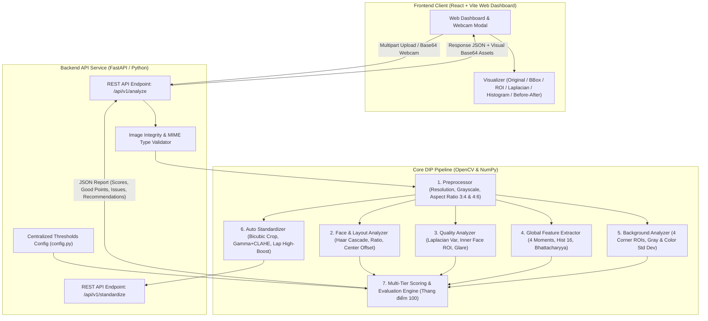

# PhotoCheck (TruePortrait-Inspector) 📸
### Hệ Thống Đánh Giá Chất Lượng Quang Học & Chuẩn Hóa Ảnh Thẻ Tự Động
> **Digital Image Processing (DIP) Core & Explainable Quality Assessment Engine**  
> Dự án môn học: **Xử lý ảnh số** | Học viện Công nghệ Bưu chính Viễn thông (PTIT)

---

## 📌 Giới thiệu tổng quan

Trong bối cảnh chuyển đổi số mạnh mẽ, ảnh thẻ chân dung là thành phần bắt buộc trong các thủ tục định danh công dân (CCCD, hộ chiếu), hồ sơ sinh viên, văn bằng và hồ sơ tuyển dụng trực tuyến. Tuy nhiên, việc kiểm tra chất lượng ảnh thủ công thường tốn nhiều thời gian, mang tính cảm tính và thiếu tính nhất quán kỹ thuật theo các tiêu chuẩn quốc tế (**ICAO Doc 9303** và **ISO/IEC 19794-5**).

**PhotoCheck (TruePortrait-Inspector)** được xây dựng nhằm giải quyết bài toán trên dựa trên triết lý **Explainable DIP (Xử lý ảnh có khả năng giải thích minh bạch)**:
* Toàn bộ hệ thống được xây dựng trên nền tảng **toán học ma trận và thống kê quang học thuần túy** (OpenCV, NumPy) thay vì phụ thuộc vào các mô hình Deep Learning dạng "hộp đen" (Black-box).
* Tập trung chuyên sâu vào nhóm **Đặc trưng Toàn cục (Global Features)** kết hợp với các bộ lọc không gian để lượng hóa độ sắc nét, phân bố ánh sáng, độ đồng nhất phông nền và bố cục hình học chân dung.
* Tích hợp **Module Chuẩn hóa DIP tự động** hỗ trợ tái cấu trúc khung hình 3:4, cân bằng sáng và làm nét thích nghi có kiểm soát.

---

## 🌟 Tính năng cốt lõi (Key Features)

### 1. Trích xuất Đặc trưng Toàn cục (Global Features DIP Core)
* **Bộ 4 mô-men thống kê mức xám (Statistical Moments):**
  * *Bậc 1 (Mean $\mu$):* Cường độ sáng trung bình toàn ảnh.
  * *Bậc 2 (Standard Deviation $\sigma$):* Độ tương phản và dải động mức xám.
  * *Bậc 3 (Skewness $S$):* Độ lệch phân bố sắc độ (xác định ảnh dồn về tối hay dồn về sáng).
  * *Bậc 4 (Kurtosis $K$):* Độ nhọn của phổ sáng (đo mức độ tập trung điểm ảnh quanh giá trị trung bình).
* **Lược đồ Grayscale Histogram 16 Bins & Chuẩn hóa xác suất $L_1$:** Biến đổi phân bố tần suất thành vector xác suất $\sum p_i = 1.0$, triệt tiêu sự phụ thuộc vào kích thước và độ phân giải ảnh.
* **Phân tích không gian màu HSV:** Bóc tách kênh Saturation (Độ bão hòa màu) và Value (Độ sáng) để phát hiện hiện tượng bạc màu da, nhợt nhạt hoặc ám màu phông nền.
* **Đo khoảng cách xác suất phân bố (Histogram Comparison):** So sánh tương quan giữa vector ảnh người dùng với **Profile ảnh thẻ chuẩn tham chiếu (Ideal Reference Profile)** thông qua hai độ đo học thuật:
  * Khoảng cách **Bhattacharyya Distance** ($d_B$).
  * Khoảng cách **Chi-Square** ($\chi^2$).
* **Phân loại quang học tự động:** Phân nhóm ảnh vào 4 trạng thái: *Đạt chuẩn quang học*, *Thiếu sáng (Dark)*, *Cháy sáng (Overexposed)*, *Bạc màu (Low Contrast)*.

### 2. Kiểm định Quang học Chuyên sâu & Chống chói lóa
* **Phát hiện bão hòa sáng / tối:** Đo tỷ lệ bão hòa cháy sáng toàn ảnh (Highlight Clipping Ratio, pixel $\ge 245$) và tỷ lệ bão hòa tối sâu (Shadow Clipping Ratio, pixel $\le 15$).
* **Phát hiện chói sáng / đèn rọi (Glare Detection):** Phân tích tương quan 4 góc nền và tỷ lệ bão hòa trắng để bắt lỗi đèn rọi trực diện gây lóa nền hoặc cháy chi tiết.
* **Bóc tách vùng ngũ quan khuôn mặt cốt lõi (Inner Face ROI):** Thu hẹp bounding box khuôn mặt để loại trừ tóc và mép phông nền biên; đo độ lóa bóng dầu trên da mặt và đo độ bất đối xứng chiếu sáng giữa 2 nửa mặt (**Asymmetric Lighting**).

### 3. Phân tích Hình học & Bố cục Chân dung chuẩn ICAO
* **Phát hiện khuôn mặt trực diện (Haar Cascade):** Kiểm tra điều kiện tiên quyết duy nhất **1 khuôn mặt hợp lệ** ($N = 1$), phát hiện ảnh không có người hoặc có từ 2 người trở lên.
* **Tỷ lệ chiều cao khuôn mặt (Face Height Ratio):** Đo tỷ lệ $\text{Ratio} = \frac{h_{\text{face}}}{H_{\text{image}}}$ với dải tiêu chuẩn thực nghiệm $30\% - 70\%$ (tương ứng $50\% - 70\%$ chiều cao đầu theo chuẩn ICAO Doc 9303).
* **Đo độ đối xứng trục tâm:** Xác định độ lệch tâm khuôn mặt so với trục dọc chính giữa bức ảnh (`center_offset`).

### 4. Đánh giá Độ sắc nét & Nhòe mờ (Sharpness Assessment)
* Ứng dụng toán tử vi phân không gian bậc hai **Laplacian** để lượng hóa biên cạnh điểm ảnh:
  $$\nabla^2 f = \frac{\partial^2 f}{\partial x^2} + \frac{\partial^2 f}{\partial y^2}$$
* Đo độ sắc nét chi tiết thông qua chỉ số **Phương sai ma trận Laplacian** $\text{Var}(\text{Laplacian})$. Ngưỡng tối thiểu $\ge 75.0$ cho phép loại bỏ chính xác các bức ảnh bị out nét, rung tay hoặc mờ nhòe chuyển động.

### 5. Phân tích Độ đồng nhất Phông nền (Background Uniformity)
* **Bóc tách 4 góc ROI độc lập:** Trích xuất 4 vùng hậu cảnh tại 4 góc biên bức ảnh (mỗi góc chiếm $12\%$ chiều rộng và chiều cao).
* **Đo độ biến thiên màu đa kênh:** Tính toán kết hợp **Grayscale Standard Deviation** và **Color Standard Deviation trên 3 kênh BGR** để phát hiện phông nền loang lổ, nền hoa văn/vật thể, bóng hắt lưng hoặc nền tối đục.

### 6. Module Chuẩn hóa Ảnh tự động (Targeted Adaptive DIP Pipeline)
* **Auto-framing & Bicubic Interpolation:** Tự động cắt căn giữa theo tỷ lệ ảnh thẻ chuẩn 3:4, đưa tỷ lệ chiều cao khuôn mặt về mức chuẩn $\sim 54\%$ bằng thuật toán nội suy Bicubic.
* **Cân bằng sáng mục tiêu:**
  * *Ảnh thiếu sáng:* Áp dụng biến đổi hàm mũ phi tuyến **Gamma Power-law** kết hợp thuật toán **CLAHE** trên kênh $L$ (Luminance) trong không gian màu **CIELAB** giúp khuôn mặt sáng rõ tự nhiên mà không làm biến dạng sắc tố màu da.
  * *Ảnh cháy sáng:* Áp dụng giải thuật **Highlight Attenuation** hạ cường độ chói sáng có kiểm soát.
* **Làm nét thích nghi có kiểm soát (Laplacian High-Boost):** **Chỉ áp dụng bộ lọc làm nét vi phân khi ảnh thực sự bị mờ nét**. Nếu ảnh gốc đã đạt độ nét chuẩn, hệ thống bảo tồn nguyên bản kết cấu bề mặt da, ngăn ngừa triệt để hiện tượng vỡ hạt hoặc gai nhiễu.

### 7. Động cơ Chấm điểm Thang 100 & Chẩn đoán Đa tầng
* **Cơ cấu trọng số chuẩn hóa (15 - 15 - 20 - 15 - 20 - 15):**
  * Kích thước ảnh & Tỷ lệ khung hình: **15 điểm**
  * Số lượng khuôn mặt hợp lệ ($N=1$): **15 điểm**
  * Tỷ lệ chiều cao khuôn mặt (ICAO): **20 điểm**
  * Độ rõ nét chi tiết (Laplacian): **15 điểm**
  * Ánh sáng & Quang học toàn cục: **20 điểm**
  * Độ đồng nhất phông nền 4 góc: **15 điểm**
* **Phân cấp 3 mức kết luận:**
  * **ĐẠT TIÊU CHUẨN (PASS):** Tổng điểm $\ge 70$ (thỏa mãn điều kiện bắt buộc có mặt).
  * **TẠM ĐẠT CHUẨN (WARNING):** Điểm từ $40 \rightarrow 69$.
  * **KHÔNG ĐẠT CHUẨN (FAIL):** Điểm $< 40$ hoặc không phát hiện mặt hợp lệ.
* **Trích xuất Điểm tốt & Khuyến nghị:** Liệt kê các ưu điểm đạt chuẩn (**Good Points**), phân tích nguyên nhân lỗi vi phạm và đưa ra hướng dẫn chụp lại cụ thể theo chuẩn ảnh thẻ quốc tế.

### 8. Interactive Web Lab & Webcam Capture
* Giao diện Web tương tác hiện đại phát triển trên nền tảng **React (Vite)**:
  * Kéo thả ảnh trực tiếp, xem trước ảnh thời gian thực.
  * Chuyển đổi linh hoạt giữa các chế độ soi: Khung mặt (Bounding Box), Vùng nền 4 góc (ROIs), Bản đồ biên cạnh (Laplacian Edge Map) và Biểu đồ Histogram động.
  * Chế độ so sánh ảnh **Trước / Sau chuẩn hóa (Before / After)** trực quan.
* **Chụp ảnh trực tiếp từ Webcam:** Tích hợp camera trình duyệt với khung oval dẫn hướng khuôn mặt và cơ chế tự động đếm ngược 3 giây trước khi chụp.

---

## 🏗️ Kiến trúc Hệ thống (System Architecture)



---

## 📈 Kết quả Thực nghiệm & Đánh giá Benchmark

Hệ thống được kiểm thử thực nghiệm trên tập dữ liệu chuẩn hóa gồm **350 ảnh** (tạo lập từ tập dữ liệu học thuật **UTKFace** kết hợp sinh lỗi có kiểm soát) với nhãn **Ground Truth** rõ ràng:

### 1. Ma trận nhầm lẫn (Confusion Matrix)

| | Dự đoán: PASS | Dự đoán: FAIL | Tổng Ground Truth |
| :--- | :---: | :---: | :---: |
| **Thực tế: PASS** | **$\text{TP} = 50$** | $\text{FN} = 0$ | **50 ảnh** |
| **Thực tế: FAIL** | $\text{FP} = 1$ | **$\text{TN} = 299$** | **300 ảnh** |
| **Tổng dự đoán** | **51** | **299** | **350 ảnh** |

### 2. Các chỉ số đo lường hiệu năng

$$\text{Accuracy} = \frac{\text{TP} + \text{TN}}{\text{Tổng mẫu}} = \frac{50 + 299}{350} = \mathbf{99.71\%}$$

$$\text{Precision} = \frac{\text{TP}}{\text{TP} + \text{FP}} = \frac{50}{50 + 1} = \mathbf{98.04\%}$$

$$\text{Recall} = \frac{\text{TP}}{\text{TP} + \text{FN}} = \frac{50}{50 + 0} = \mathbf{100.00\%}$$

$$\text{F1-Score} = 2 \times \frac{\text{Precision} \times \text{Recall}}{\text{Precision} + \text{Recall}} = \mathbf{99.01\%}$$

### 3. Tỷ lệ phát hiện chính xác theo từng nhóm lỗi

| Nhóm lỗi kiểm thử | Số lượng mẫu | Dự đoán đúng | Dự đoán sai | Độ chính xác ($\%$) |
| :--- | :---: | :---: | :---: | :---: |
| **FAIL_BACKGROUND** (Phông nền tạp, loang lổ, bokeh) | 50 | 50 | 0 | **100.0%** |
| **FAIL_BLUR** (Ảnh out nét, mờ nhòe chuyển động) | 50 | 50 | 0 | **100.0%** |
| **FAIL_DARK** (Ảnh thiếu sáng nghiêm trọng) | 50 | 50 | 0 | **100.0%** |
| **FAIL_FACE_COUNT** (Ảnh chụp nhiều người hoặc không có mặt) | 50 | 50 | 0 | **100.0%** |
| **FAIL_FACE_SIZE** (Người đứng quá xa, tỷ lệ mặt nhỏ) | 50 | 50 | 0 | **100.0%** |
| **FAIL_OVEREXPOSED** (Ảnh cháy sáng, quá phơi sáng) | 50 | 49 | 1 | **98.0%** |

---

## 📁 Cấu trúc Thư mục Dự án

```
PhotoCheck/
├── backend/                                  # Dịch vụ Backend API (FastAPI)
│   ├── app/
│   │   ├── core/
│   │   │   ├── config.py                     # Quản lý dải ngưỡng thực nghiệm tập trung
│   │   │   ├── preprocessor.py               # Tiền xử lý, kích thước và tỷ lệ khung hình
│   │   │   ├── face_analyzer.py              # Nhận diện mặt (Haar Cascade) & đo tỷ lệ ICAO
│   │   │   ├── quality_analyzer.py           # Đo độ nét Laplacian & quang học Inner Face ROI
│   │   │   ├── global_feature_extractor.py   # Lõi Đặc trưng Toàn cục (Moments, Hist, Bhattacharyya)
│   │   │   ├── background_analyzer.py        # Đo độ đồng nhất phông nền (4 góc ROI)
│   │   │   ├── auto_standardizer.py          # Module chuẩn hóa DIP thích nghi (Crop 3:4, Gamma+CLAHE)
│   │   │   └── evaluator.py                  # Động cơ chấm điểm thang 100 & chẩn đoán đa tầng
│   │   ├── pipeline.py                       # Pipeline tích hợp toàn bộ luồng xử lý ảnh
│   │   └── main.py                           # REST API Service (Endpoints: /analyze, /standardize)
│   └── tests/                                # Bộ test tự động
├── frontend/                                 # Ứng dụng Web Dashboard (React + Vite)
│   ├── src/
│   │   ├── App.jsx                           # Giao diện Web tương tác hoàn chỉnh & Webcam Modal
│   │   ├── App.css                           # Enterprise Dark UI Styling & Animations
│   │   └── main.jsx                          # Điểm khởi chạy React DOM
│   ├── package.json                          # Dependencies thư viện Frontend
│   └── vite.config.js                        # Cấu hình Vite build tool
├── benchmark_results/                        # Kết quả thực nghiệm khoa học
│   ├── benchmark_details.csv                 # Bảng chi tiết kết quả 350 ảnh kiểm thử
│   ├── benchmark_report.txt                  # Báo cáo tổng hợp số liệu Benchmark
│   └── confusion_matrix.png                  # Biểu đồ ma trận nhầm lẫn
├── demo_samples/                             # Bộ ảnh mẫu phục vụ demo & kịch bản kiểm thử
│   ├── 01_anh_chuan_PASS.jpg
│   ├── 02_anh_thieu_sang_DARK.jpg
│   ├── 03_anh_chay_sang_OVEREXPOSED.jpg
│   ├── 04_anh_mo_nhet_BLUR.jpg
│   ├── 05_anh_2_nguoi_FACE_COUNT.jpg
│   ├── 06_anh_mat_nho_FACE_SIZE.jpg
│   ├── 07_anh_nen_tap_BACKGROUND.jpg
│   └── KICH_BAN_DEMO.md                      # Kịch bản các bước chạy thử mẫu
├── build_dataset.py                          # Script tự động tạo 350 ảnh kiểm thử từ UTKFace
├── benchmark_eval.py                         # Script chạy Benchmark đánh giá toàn diện
├── run_app.bat                               # Script khởi động 1-click toàn bộ hệ thống
└── README.md                                 # Tài liệu dự án
```

---

## 🚀 Hướng dẫn Cài đặt & Chạy ứng dụng

### 1. Yêu cầu môi trường
* **Python:** Phiên bản `3.10` trở lên.
* **Node.js:** Phiên bản `18.0` trở lên và trình quản lý gói `npm`.

### 2. Khởi chạy nhanh bằng script 1-Click (Khuyên dùng trên Windows)
Chỉ cần nhấp đúp chuột vào file:
```cmd
run_app.bat
```
Script sẽ tự động khởi động đồng thời cả Backend FastAPI (Port `8000`) và Frontend Vite React (Port `5173`).

---

### 3. Khởi chạy thủ công từng dịch vụ

#### Bước 3.1: Khởi động Backend API
Mở cửa sổ dòng lệnh tại thư mục gốc của dự án:
```bash
# Cài đặt các thư viện cần thiết nếu chưa cài
pip install fastapi uvicorn opencv-python numpy pydantic python-multipart

# Chạy server FastAPI
uvicorn backend.app.main:app --reload --port 8000
```
* **Địa chỉ Backend API:** `http://127.0.0.1:8000`
* **Tài liệu Swagger API Documentation:** `http://127.0.0.1:8000/docs`

#### Bước 3.2: Khởi động Frontend Web Dashboard
Mở một cửa sổ dòng lệnh thứ hai:
```bash
# Di chuyển vào thư mục frontend
cd frontend

# Cài đặt dependencies
npm install

# Khởi chạy dev server
npm run dev
```
* **Giao diện Web:** Mở trình duyệt truy cập `http://localhost:5173`.

---

### 4. Chạy thực nghiệm Benchmark
Để kiểm thử lại toàn bộ 350 ảnh mẫu và xuất báo cáo độ chính xác:
```bash
python benchmark_eval.py
```
Kết quả báo cáo và ma trận nhầm lẫn sẽ được tự động lưu trong thư mục `benchmark_results/`.

---

## 📚 Tài liệu Tham khảo & Tiêu chuẩn Học thuật

1. **Rafael C. Gonzalez, Richard E. Woods (2018):** *Digital Image Processing*, 4th Edition, Pearson.
   * Chương 2: Digital Image Fundamentals & Spatial Filtering (Bộ lọc vi phân Laplacian).
   * Chương 3: Intensity Transformations & Histogram Processing (Biến đổi Gamma, Histogram Equalization).
   * Chương 6: Color Image Processing & Global Feature Analysis (Không gian màu HSV/LAB, mô-men thống kê).
2. **ICAO Doc 9303:** *Machine Readable Travel Documents (MRTDs)* – Part 3: Specifications Common to all MRTDs (Tiêu chuẩn quốc tế về bố cục, phông nền và chiếu sáng ảnh thẻ định danh).
3. **ISO/IEC 19794-5:** *Information technology – Biometric data interchange formats – Part 5: Face image data* (Quy chuẩn kỹ thuật dữ liệu ảnh khuôn mặt).
4. **Paul Viola, Michael Jones (2001):** *Rapid Object Detection using a Boosted Cascade of Simple Features*, CVPR (Thuật toán phát hiện khuôn mặt Haar Cascade).
5. **Karel Zuiderveld (1994):** *Contrast Limited Adaptive Histogram Equalization (CLAHE)*, Graphics Gems IV, Academic Press.

---

## 📄 Bản quyền & Giấy phép
Dự án được xây dựng phục vụ mục đích nghiên cứu học thuật và đồ án môn học. Toàn bộ mã nguồn tuân thủ theo giấy phép **MIT License**.
